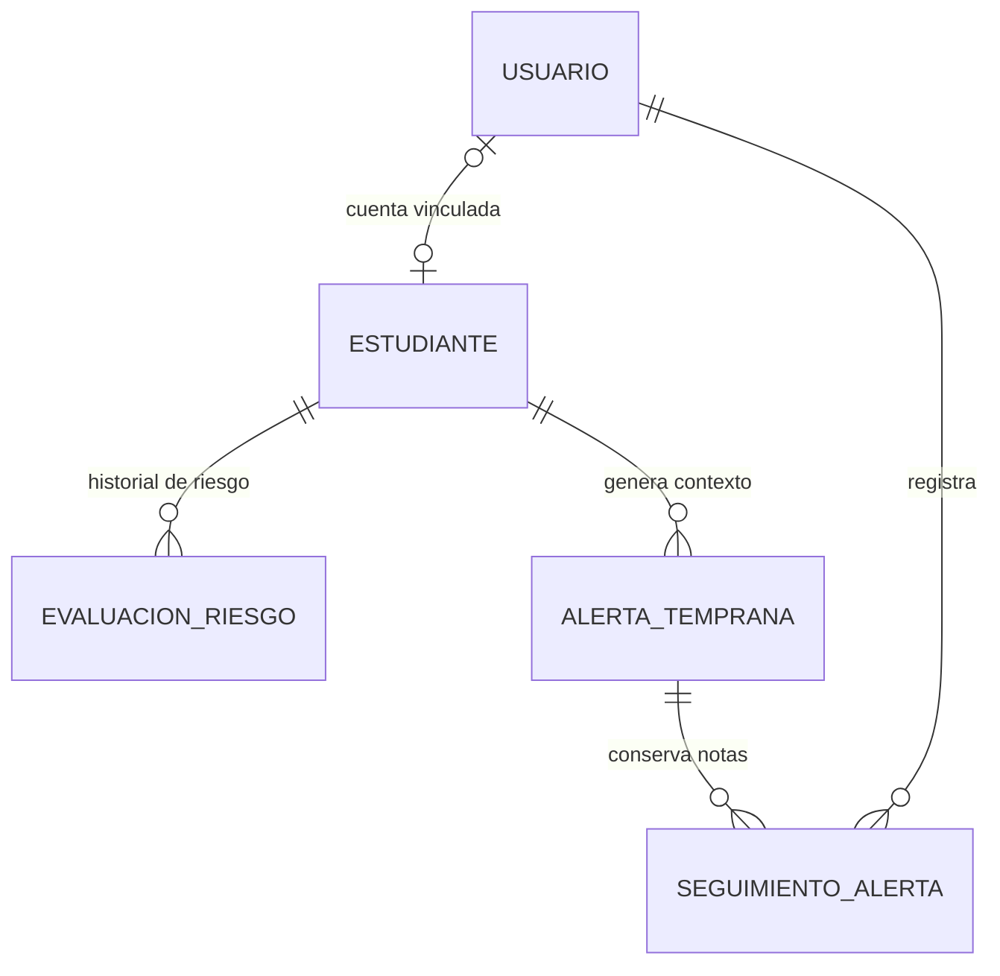

# EduAlerta — Persistencia de estudiantes, riesgo y alertas

**Versión:** 0.2  
**Estado:** Propuesta de integración para la entrega académica  
**Tecnologías:** Spring Boot, Spring Data JPA, PostgreSQL y React/TypeScript

## Alcance de este bloque

El objetivo es quitar los datos de riesgo y alertas de los mocks/localStorage y guardarlos mediante la API REST en PostgreSQL. Las cuentas administradas desde `AdminUsuarios.tsx` ya utilizan el endpoint administrativo de Spring Boot y la tabla `usuario`.

## Modelo ER actualizado

### Entidades persistidas

| Tabla | Responsabilidad |
|---|---|
| `usuario` | Cuenta de acceso, correo único, rol, estado y hash de contraseña. |
| `estudiante` | Código, nombres, apellidos, estado de ficha, grado y promedio actual. Puede vincularse a una cuenta. |
| `evaluacion_riesgo` | Historial de nivel de riesgo con fecha, fuente y observaciones. El formulario actual registra evaluaciones manuales. |
| `alerta_temprana` | Señal relacionada con un estudiante, nivel asociado al momento de crearla, estado y fechas. |
| `seguimiento_alerta` | Observaciones fechadas asociadas a una alerta y al usuario autenticado que las registra. |

`grado` y `promedio_actual` son el resumen académico vigente para la primera entrega. La libreta de calificaciones por asignatura y período queda como una ampliación posterior; no se debe presentar este promedio agregado como un historial detallado de notas.

## Justificación relacional

Se usa PostgreSQL porque las relaciones entre cuentas, estudiantes, evaluaciones de riesgo, alertas y seguimientos son explícitas; las claves foráneas preservan la integridad y las transacciones permiten guardar una operación coherente. Además, los registros históricos deben consultarse, ordenarse y cruzarse por estudiante, estado y fecha. Un modelo relacional resulta más adecuado que documentos aislados para estos datos estructurados y relacionados.

## Reglas de negocio

1. El nivel de riesgo vigente es la evaluación de riesgo más reciente. Si no existe, la API devuelve `sin_evaluar`.
2. Cambiar un nivel de riesgo crea una nueva fila en `evaluacion_riesgo`; no sobrescribe el historial.
3. La fuente `MANUAL` indica que la clasificación se registró en un formulario por el personal. No equivale a una predicción ML.
4. La alerta conserva una instantánea de su nivel de riesgo al momento de crearla; cambiar después el riesgo del estudiante no reescribe automáticamente la alerta anterior.
5. Estados de alerta aceptados: `Nueva`, `En seguimiento` y `Revisada`.
6. Desactivar un estudiante es una baja lógica. Las alertas y seguimientos históricos no se eliminan.
7. Las notas de seguimiento toman el responsable de la identidad JWT autenticada; no aceptan un nombre arbitrario como responsable.
8. El promedio del formulario es opcional y se valida en una escala de 0 a 5.

## Endpoints expuestos por este bloque

| Método | Ruta | Función | Permisos esperados |
|---|---|---|---|
| `GET` | `/api/estudiantes` | Listar ficha, grado, promedio y riesgo actual | Administrador, docente, orientador |
| `POST` | `/api/estudiantes` | Crear ficha e indicadores iniciales | Administrador, docente |
| `PUT` | `/api/estudiantes/{id}` | Actualizar ficha e historial de riesgo | Administrador, docente |
| `DELETE` | `/api/estudiantes/{id}` | Baja lógica | Administrador, docente |
| `GET` | `/api/alertas` | Consultar alertas desde PostgreSQL | Personal autorizado |
| `POST` | `/api/alertas` | Crear alerta | Personal autorizado |
| `PATCH` | `/api/alertas/{id}/estado` | Actualizar estado | Personal autorizado |
| `GET` | `/api/alertas/{id}/seguimientos` | Consultar notas | Personal autorizado |
| `POST` | `/api/alertas/{id}/seguimientos` | Guardar una nota con responsable autenticado | Personal autorizado |
| `GET` | `/api/admin/usuarios` | Listar cuentas | Administrador |
| `POST` | `/api/admin/usuarios` | Crear cuentas | Administrador |

## Consideraciones de migración

El entorno actual usa `spring.jpa.hibernate.ddl-auto=update` para agregar las nuevas columnas/tablas de desarrollo sin borrar los datos existentes. Antes de una puesta en producción se recomienda pasar a migraciones versionadas con Flyway o Liquibase y cambiar el esquema gestionado a `validate`.

El archivo `backend/db/seed-demo.sql` es opcional e idempotente para datos con código `EA-DEMO-*`. Los nombres, promedios y niveles incluidos son ficticios, solo para demostración; no deben presentarse como estudiantes reales ni como resultados de un modelo predictivo validado.
