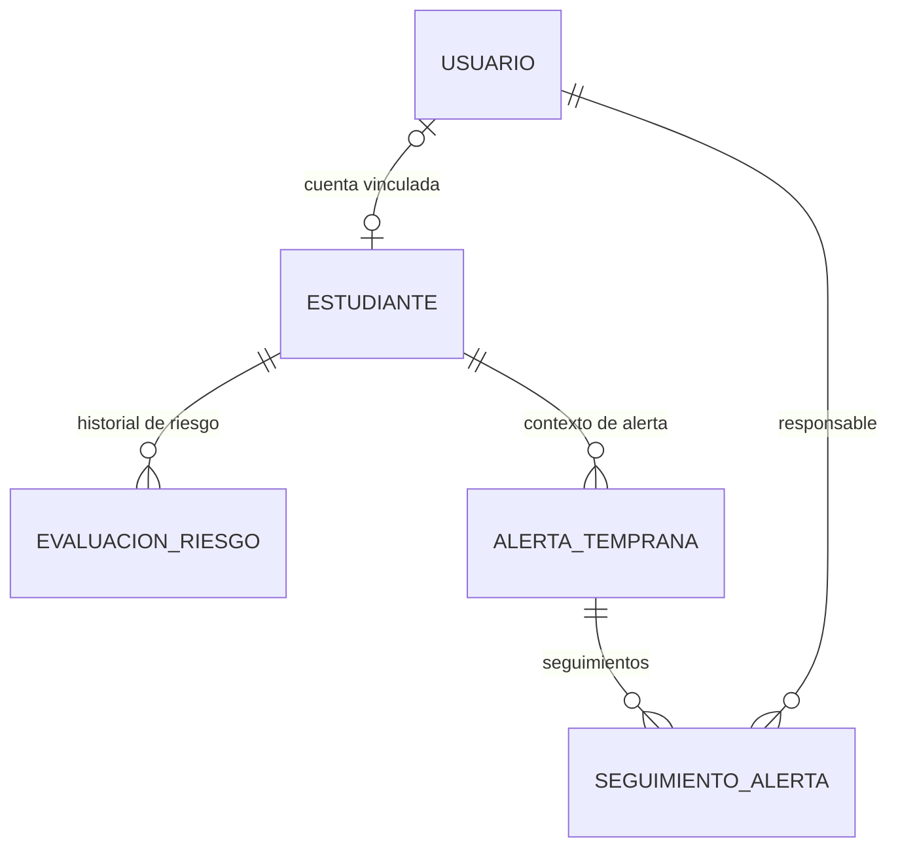

# EduAlerta — Relaciones de persistencia implementadas/propuestas para la entrega

**Versión:** 0.3 · **Estado:** propuesta de integración; validar en el entorno local antes de declarar probada.

## Fuente de verdad por tipo de dato

| Dato | Fuente prevista en el bloque |
|---|---|
| Cuentas, rol, estado, hash de contraseña | PostgreSQL: `usuario` |
| Código, nombre, estado de ficha, grado, promedio actual | PostgreSQL: `estudiante` |
| Nivel de riesgo vigente e historial fechado | PostgreSQL: `evaluacion_riesgo` (el vigente es el registro más reciente) |
| Señal, nivel capturado, estado y fechas | PostgreSQL: `alerta_temprana` |
| Notas, fecha y responsable de seguimiento | PostgreSQL: `seguimiento_alerta` |
| Preguntas y resultados vocacionales, asistencia detallada y notas por materia/período | Continúan fuera del alcance de este bloque hasta su integración a SQL |

## Justificación relacional

Las entidades mantienen relaciones obligatorias o opcionales y claves foráneas, y se necesita consultar el historial temporal por estudiante y alerta. PostgreSQL permite asegurar integridad referencial y transacciones al crear alertas y seguimientos. No se utiliza una base documental porque la mayoría de los registros son estructurados y relacionados.

## Reglas clave

- Cambiar el riesgo crea una nueva evaluación cuando el nivel o las observaciones han cambiado; editar solo nombre o código no debe generar una evaluación duplicada.
- El nivel asociado a una alerta es una instantánea al momento de crearla.
- Los estados de alerta permitidos son `Nueva`, `En seguimiento` y `Revisada`.
- Las notas de seguimiento guardan la identidad del usuario tomada del JWT.
- Una baja de estudiante es lógica para mantener el historial.
- Los niveles manuales no deben describirse como predicciones de IA.
