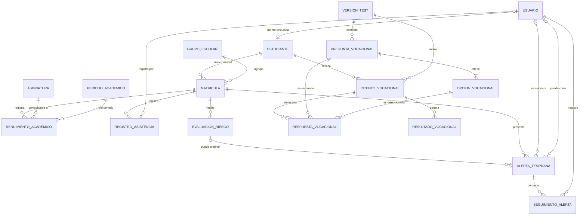

# EduAlerta — Modelo conceptual de datos

**Versión:** 0.1  
**Fecha:** 12 de octubre de 2026  
**Estado:** Borrador de diseño  
**Proyecto:** EduAlerta — Aplicación híbrida inteligente para la gestión del conocimiento y prevención de la deserción escolar.

## 1. Propósito

Este documento define el modelo conceptual inicial de información de EduAlerta. Identifica las entidades principales, sus relaciones y las reglas que deberán respetarse al diseñar la base de datos PostgreSQL y las API del backend.

El modelo busca que los módulos de **Alertas Tempranas** y **Orientación Vocacional** puedan desarrollarse de manera independiente sobre una base de datos, una identidad de usuario y unas reglas compartidas.

## 2. Estado y alcance del documento

Este documento es un artefacto de diseño, no una descripción de funcionalidades ya implementadas en el backend. En el estado actual, el frontend utiliza datos de demostración, servicios de frontend y persistencia local mediante `localStorage`.

El modelo se considera una **propuesta inicial**. Antes de crear las tablas físicas deberán revisarse los campos, las restricciones, los permisos y las reglas específicas de la institución educativa.

### Incluye en esta primera versión

- Usuarios y roles de acceso.
- Ficha del estudiante y su historial de matrículas.
- Grupos escolares, asignaturas y períodos académicos.
- Registros resumidos de rendimiento académico y asistencia.
- Evaluaciones de riesgo, alertas tempranas y seguimientos.
- Versiones del test vocacional, preguntas, opciones, intentos, respuestas y resultados.

### Fuera del alcance inicial

- Facturación, pagos, gestión de personal y nómina.
- Horarios, salones y programación detallada de cada sesión de clase.
- Integración automática con plataformas externas de notas o asistencia.
- Un almacén de datos institucional o una arquitectura de analítica empresarial.
- Un modelo predictivo entrenado y validado con datos reales. El servicio de aprendizaje automático sigue siendo una parte prevista de la arquitectura, no una función que deba darse por implementada.
- Pruebas psicométricas validadas o recomendaciones vocacionales con valor de diagnóstico.

Cualquier ampliación que supere este alcance deberá documentarse como una propuesta futura y justificarse antes de incorporarla.

## 3. Principios de diseño

1. **Fuente de verdad única:** el backend y PostgreSQL serán la fuente persistente de los datos del sistema. El frontend no debe mantener copias locales que sustituyan a los registros oficiales.
2. **Historial conservado:** matrículas, rendimiento, asistencia, evaluaciones de riesgo, alertas, seguimientos e intentos vocacionales deben poder consultarse históricamente.
3. **Separación entre evaluación y alerta:** una evaluación de riesgo representa el resultado de un análisis; una alerta representa una situación que requiere revisión y seguimiento.
4. **Supervisión humana:** una estimación automatizada no confirma que un estudiante vaya a desertar y no debe utilizarse por sí sola para sancionarlo o limitar sus oportunidades.
5. **Trazabilidad:** los cambios y las acciones relevantes deben asociarse con fechas, responsables y versiones de los métodos cuando corresponda.
6. **Mínima recopilación de datos:** se almacenará solo la información necesaria para las funciones académicas y de orientación acordadas.
7. **Seguridad en el backend:** ocultar una opción de navegación no sustituye la validación de identidad, rol y acceso al recurso en cada API.
8. **Diseño mantenible:** se priorizan entidades y relaciones comprensibles para el alcance académico, sin incorporar infraestructura innecesaria.

## 4. Modelo entidad-relación conceptual

El siguiente diagrama representa las entidades propuestas y sus relaciones principales. No representa todavía tipos SQL, índices ni todas las restricciones que tendrá el esquema físico.

### 4.1 Lectura de las relaciones

- Un usuario puede tener vinculada como máximo una ficha de estudiante; una ficha puede existir sin cuenta de acceso, por ejemplo, si el estudiante todavía no utiliza el módulo.
- Un estudiante puede acumular matrículas de diferentes años lectivos. Cada matrícula pertenece a un estudiante y a un grupo escolar.
- El rendimiento se organiza por matrícula, asignatura y período académico. La primera versión guarda un registro resumido por combinación; el detalle de cada evaluación individual queda fuera del alcance inicial.
- La asistencia se registra por fecha y matrícula. En el alcance inicial se interpreta como un registro diario, no como asistencia por cada hora o clase.
- Una matrícula puede recibir varias evaluaciones de riesgo. Una alerta puede estar vinculada a una evaluación, pero también puede originarse manualmente o por una señal distinta; por eso la referencia a la evaluación puede ser opcional.
- Una alerta puede acumular varios seguimientos, cada uno asociado con el usuario que lo registra.
- Cada intento vocacional corresponde a un estudiante y una versión del test. Guarda respuestas y puede generar un resultado por cada área vocacional calculada.

## 5. Descripción de las entidades

### 5.1 Entidades compartidas

| Entidad | Responsabilidad |
|---|---|
| `Usuario` | Identidad de acceso, credenciales protegidas, rol y estado de la cuenta. |
| `Estudiante` | Ficha básica del estudiante. Es la referencia común para las funciones académicas y vocacionales. |
| `GrupoEscolar` | Grupo de un grado y año lectivo determinado, por ejemplo, 10.º A de 2026. |
| `Matricula` | Vincula al estudiante con un grupo escolar durante un año lectivo; permite conservar el historial académico. |
| `Asignatura` | Catálogo de materias utilizadas para registrar rendimiento. |
| `PeriodoAcademico` | Período de evaluación dentro de un año lectivo. |
| `RendimientoAcademico` | Nota resumida de una asignatura para una matrícula y período. |
| `RegistroAsistencia` | Estado diario de asistencia de una matrícula y fecha. |

### 5.2 Entidades de Alertas Tempranas

| Entidad | Responsabilidad |
|---|---|
| `EvaluacionRiesgo` | Conserva el resultado estimado de un análisis, la fecha, la metodología y su versión. |
| `AlertaTemprana` | Representa una señal que debe ser revisada, su nivel, su estado y su asignación. |
| `SeguimientoAlerta` | Registra una observación o acción de seguimiento y su responsable. |

### 5.3 Entidades de Orientación Vocacional

| Entidad | Responsabilidad |
|---|---|
| `VersionTest` | Identifica una versión del instrumento vocacional y de su regla de cálculo. |
| `PreguntaVocacional` | Contiene cada pregunta en una versión específica del test. |
| `OpcionVocacional` | Define las opciones de respuesta y su puntuación o correspondencia con un área. |
| `IntentoVocacional` | Representa una ejecución del test, con fecha de inicio, estado y fecha de finalización. |
| `RespuestaVocacional` | Conserva la opción elegida para una pregunta dentro de un intento. |
| `ResultadoVocacional` | Conserva el puntaje calculado para un área vocacional de un intento determinado. |

## 6. Reglas de negocio iniciales

1. Los roles permitidos en la primera definición son `administrador`, `docente`, `orientador` y `estudiante`.
2. La contraseña de un usuario nunca se almacena en texto plano. Se almacena únicamente un hash generado con un algoritmo adecuado para contraseñas.
3. El correo de acceso deberá ser único, normalizado y validado. La regla de si todos los estudiantes necesitan cuenta queda pendiente de la política institucional.
4. Un estudiante puede tener varias matrículas históricas, pero no debe tener dos matrículas activas simultáneas para el mismo año lectivo, salvo que una regla institucional aprobada indique lo contrario.
5. El grupo escolar está asociado a un año lectivo. Las matrículas históricas no se deben reutilizar para representar un cambio de año o de grupo.
6. El rendimiento resumido debe ser único por matrícula, asignatura y período académico. La escala de calificaciones (por ejemplo, mínimo y máximo permitido) debe confirmarse con la institución antes de imponer la restricción definitiva.
7. En la primera versión, cada registro de asistencia representa un día para una matrícula y tiene un estado válido: `Presente`, `Retardo`, `Ausencia justificada` o `Ausencia sin justificar`. Un registro diario no puede repetirse para la misma matrícula y fecha.
8. Cada evaluación de riesgo conserva la fecha de cálculo, el nivel estimado y la versión de la metodología o modelo. Si se guarda una probabilidad estimada, su rango debe ser de 0 a 1.
9. Los niveles iniciales de riesgo son `bajo`, `medio` y `alto`. Los umbrales y la forma de calcularlos todavía deben definirse y validarse.
10. Una alerta tiene un estado operativo: `Nueva`, `En seguimiento` o `Revisada`. Revisar una alerta no implica, por sí mismo, que el problema del estudiante esté resuelto.
11. Una alerta puede ser automática o manual. En una alerta manual debe quedar identificado el usuario que la crea; en una alerta automática se debe conservar su origen y la evaluación o regla que la generó cuando aplique.
12. Cada seguimiento de alerta debe estar asociado a un usuario autenticado y a una alerta existente.
13. Un intento vocacional pertenece a un estudiante y a una versión específica del test. Las respuestas y resultados de intentos anteriores no deben sobrescribirse cuando el estudiante vuelva a realizarlo.
14. Una pregunta pertenece a una versión del test y tiene opciones definidas para esa misma versión. Cada intento admite como máximo una respuesta por pregunta.
15. Los resultados vocacionales deben identificar la versión de la regla de cálculo. La interpretación de las áreas es orientativa; no se presentará como diagnóstico ni como prueba psicométrica validada.
16. Los datos de estudiantes, alertas y respuestas son sensibles desde el punto de vista de privacidad escolar. El acceso debe validarse en el backend y limitarse a la finalidad y rol autorizados.
17. Para conservar la trazabilidad, se debe evitar borrar físicamente información que respalde procesos históricos. Para registros principales se preferirá una marca de estado o inactivación, y las políticas de retención y eliminación deberán definirse con la institución.

## 7. Correspondencia con el frontend actual

| Archivo o servicio actual | Responsabilidad que migrará al backend |
|---|---|
| `src/types.ts` | Los tipos de TypeScript deberán alinearse con los DTO y las respuestas de API, sin asumir que los tipos del frontend son el esquema definitivo. |
| `src/data/mock.ts` | Datos iniciales de demostración; pueden servir para semillas o pruebas, no como fuente de verdad en producción. |
| `src/services/students.service.ts` | Consultar y gestionar estudiantes mediante la API de Spring Boot. |
| `src/services/student-academic.service.ts` | Consultar rendimiento y asistencia históricos mediante la API. |
| `src/services/alerts.service.ts` | Consultar alertas, cambiar su estado y registrar seguimientos en el backend. |
| `src/services/vocational.service.ts` | Guardar intentos, borradores, respuestas e historial vocacional mediante la API. |
| `localStorage` | Dejará de ser el repositorio principal de los datos compartidos. Su uso futuro se limitará a necesidades justificadas de experiencia de usuario, no a autorización ni almacenamiento oficial. |

El frontend no debe enviar ni elegir libremente la identidad del usuario autenticado para consultar datos protegidos. El backend obtendrá la identidad de la sesión o token validado y comprobará sus permisos.

## 8. Decisiones pendientes de validar

Antes de crear el esquema físico deben cerrarse como mínimo estas decisiones:

- La escala oficial de calificaciones y las reglas para calcular promedios.
- Si asistencia se registra por día o por sesión/clase. Este documento adopta el registro diario como alcance inicial.
- Los datos mínimos de la ficha del estudiante y el identificador institucional disponible.
- Si la institución exige que cada estudiante tenga cuenta de acceso o si existen fichas gestionadas únicamente por personal autorizado.
- Quién puede crear, asignar, cambiar de estado y cerrar alertas.
- Los indicadores que podrán alimentar una evaluación de riesgo, los umbrales y cómo se explicará una estimación.
- La regla de cálculo vocacional, sus puntuaciones y la forma de presentar resultados.
- Los tiempos de conservación, anonimización y eliminación de los datos.
- La política de acceso por grado, grupo y relación de responsabilidad del docente/orientador.
- La forma de auditar cambios críticos y errores de integración.

## 9. Criterios para considerar cerrado el diseño conceptual

El modelo conceptual podrá aprobarse cuando:

- Todas las entidades propuestas tengan una finalidad justificada por el alcance.
- Las relaciones y cardinalidades sean comprendidas por el equipo.
- Las reglas críticas de negocio y acceso estén documentadas.
- Las decisiones pendientes que afecten claves, relaciones o integridad se hayan resuelto.
- El modelo se haya contrastado con las pantallas, servicios y tipos del frontend.
- Exista una versión revisada del diccionario de datos y, después, del esquema lógico/físico.

## 10. Historial de cambios

| Versión | Fecha | Cambio |
|---|---|---|
| 0.1 | 12-10-2026 | Borrador inicial de entidades, relaciones, alcance y reglas de negocio. |

---

**Nota de estado:** Documento de diseño. No certifica la existencia de tablas PostgreSQL, endpoints de backend, autenticación real ni un modelo predictivo validado.
